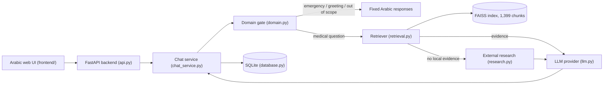

# DiagnoTech – Arabic Respiratory Medical Assistant

DiagnoTech is a local web application that answers Arabic questions about
respiratory and chest diseases. Answers are generated only from a local
knowledge base (retrieval-augmented generation): the system retrieves
relevant records first, then asks a language model to answer in Arabic
using only that retrieved evidence, and shows the sources with every
answer. If no reliable evidence is found, the system says so instead of
inventing an answer.

The user interface is Arabic only (RTL). The code, comments, and this
document are in English. The system runs on a normal computer with no
GPU: embeddings and generation both run on CPU.

## How it works

Every user message goes through the same steps:

1. **Domain gate** (`domain.py`). The message is classified before any
   retrieval. Emergency phrasing (for example severe breathing
   difficulty or chest pain) returns escalation guidance immediately.
   Greetings get a fixed welcome message, and questions outside
   respiratory medicine get a fixed out-of-scope message.
2. **Retrieval** (`retrieval.py`, `diseases.py`). The Arabic question is
   normalized (`arabic.py`: hamza forms, ة/ه, ى/ي, tatweel and
   diacritics are unified) and embedded with a multilingual model, so an
   Arabic query can match English documents. An Arabic-to-English
   disease lexicon detects the disease named in the question and adds
   its English name, plus English aspect terms (symptoms, causes,
   prevention, …), to the search query; chunks belonging to the
   detected disease receive a score boost. Results below a similarity
   threshold are discarded.
3. **Grounded generation** (`chat_service.py`, `prompts.py`, `llm.py`).
   If evidence passed the threshold, the language model answers in
   Arabic using only that evidence. The prompt forbids adding facts
   from outside the evidence, giving a final diagnosis, or stating
   medication dosages that are not in the evidence. If the model still
   answers that the information is unavailable although evidence
   exists, generation is retried once with a firmer instruction.
4. **External fallback** (`research.py`). If there is no local
   evidence, the question may be searched on a small set of trusted
   medical sites (who.int, nhs.uk, cdc.gov, mayoclinic.org). Answers
   built from those results are marked as external.
5. **Unavailable**. If neither local nor external evidence is found,
   the fixed message "عذراً، هذه المعلومة غير متوفرة حالياً في قاعدة
   المعرفة." is returned.

Both sides of every conversation, together with the answer state and
the source references, are stored in a SQLite database.

## Architecture



Main modules in `src/diagnotech/`:

| Module | Responsibility |
|---|---|
| `config.py` | All settings, overridable with `DIAGNOTECH_*` environment variables |
| `arabic.py` | Arabic text normalization for display and for matching |
| `domain.py` | Message classification: emergency, greeting, in-scope, out-of-scope |
| `diseases.py` | Arabic→English disease lexicon, aspect detection, typo-tolerant matching |
| `ingestion.py` | Loads, merges, cleans, and deduplicates the source datasets |
| `chunking.py` | Splits records into retrievable chunks (900 chars, 150 overlap) |
| `embeddings.py` | Embedding backends: sentence-transformers (e5) with a TF-IDF fallback |
| `vector_store.py` | FAISS index (IndexFlatIP) with a NumPy fallback, plus chunk metadata |
| `retrieval.py` | Query expansion, thresholding, disease boost, per-record limits |
| `llm.py` | Generation providers: local transformers model, OpenAI-compatible endpoint, explicit unavailable mode |
| `prompts.py` | System prompt and the fixed Arabic messages (unavailable, disclaimer) |
| `research.py` | Site-restricted web search over trusted medical domains |
| `chat_service.py` | Orchestrates the flow above and persists conversations |
| `database.py` | SQLite storage for conversations and messages |
| `api.py` | FastAPI endpoints and static serving of the frontend |
| `services.py` | Assembles the retriever and builds/loads the index |
| `main.py` | Entry point: `python -m diagnotech.main` |

## Answer states

The API returns one of these states with every answer, and the UI shows
it as a badge:

| State | Meaning |
|---|---|
| `known` | Answered from local knowledge-base evidence; sources are attached |
| `external` | Answered from trusted external sites; sources are attached and marked external |
| `unavailable` | No reliable evidence found locally or externally; fixed message, nothing fabricated |
| `emergency` | The message describes a possible emergency; escalation guidance (call 123 in Egypt or go to the nearest emergency department) is returned instead of a normal answer |
| `greeting` | Fixed welcome message |
| `out_of_scope` | The question is not about respiratory/chest medicine |
| `error` | Generation failed (for example the local model could not be loaded); the retrieved sources are still returned when available |

## Tech stack

- Python 3.11+, FastAPI + Uvicorn, Pydantic v2
- Embeddings: `intfloat/multilingual-e5-small` (384 dimensions) via
  sentence-transformers; scikit-learn TF-IDF as an automatic fallback
- Vector search: FAISS (`faiss-cpu`, IndexFlatIP) with a NumPy fallback
- Generation: `Qwen/Qwen2.5-1.5B-Instruct` via transformers on CPU
  (PyTorch CPU build), or any OpenAI-compatible endpoint
- Data processing: pandas + openpyxl; storage: SQLite
- Frontend: plain HTML/CSS/JavaScript, no frameworks or CDN dependencies
- Tests: pytest

Exact version ranges are in `requirements.txt`.

## Dataset

Two source files are kept unchanged in `data/raw/`:

- `DiagnoTech_Respiratory_Clean__1.xlsx` — 19,584 rows, Arabic column
  headers and an Arabic category column.
- `data_chatbot_0_860u.csv` — 19,607 rows; a superset of the XLSX by
  record id, with English headers and an extra review-flag column.

The ingestion pipeline merges both files (the XLSX is the primary
source; the CSV contributes the review flag and 23 records that exist
only there), drops 1 record with a missing question or answer, removes
5,131 exact duplicates, and produces **14,475 clean records**
(`data/processed/`, with per-run statistics in
`data/processed/ingestion_stats.json`). After cleaning, the records
come from: Medical MCQ exam sets 14,014; Mayo Clinic 445; unknown
source 16. The question/answer content itself is in English.

### Which records may answer patients, and why

Only the **445 Mayo Clinic patient-education records** are marked
patient-usable, covering **81 disease topics**. They are the only
records indexed for patient answers (1,399 chunks). This is a
deliberate safety rule, not a data loss:

- The ~14k Medical MCQ records are exam questions whose answer options
  are not present in the data at all. 3,408 of their answers literally
  say things like "Ans. is 'c'", referring to options that do not
  exist in the file, so they cannot be shown to a patient as answers.
  They are preserved in `data/processed/` for reference.
- Records whose source is unknown are not treated as patient-usable.
- The CSV flags 19,585 of its rows with `needs_review`; in practice the
  whole dataset should be treated as not yet reviewed by a clinician.

### Known coverage gaps

The 445 Mayo records do not cover every respiratory topic. In
particular there are **no records at all for pneumonia, the common
cold, or acute bronchitis**, so questions about them return no local
evidence and fall back to external research or the unavailable message.
The knowledge base is the main limiting factor of the system today.

Redistribution rights for the Mayo Clinic content should be confirmed
before using this project outside a coursework setting.

## Measured results

Retrieval quality was measured with two scripts in `scripts/`, run
against the built index:

- `evaluate_retrieval.py` — 18 Arabic questions, each mapped to the
  Mayo records of the same disease and aspect that legitimately answer
  it. Result: **Recall@5 = 1.0, MRR = 0.9444** (16 of 18 correct at
  rank 1).
- `evaluate_variants.py` — 19 questions written the way users actually
  type (hamza dropped or changed, ة written as ه, ى instead of ي,
  dialect phrasing, small typos), run at the production threshold.
  Result: **19/19 answered, with evidence from the correct disease**.

The test suite (`tests/`) contains **45 pytest tests, all passing**
(unit, integration, and API tests).

These numbers describe retrieval on topics that exist in the knowledge
base. They do not measure the quality of the generated Arabic text, and
they say nothing about topics the knowledge base does not contain.

## Setup and running

Requirements: Python 3.11 or newer, about 4 GB of free disk space for
the model files, and an internet connection for the one-time model
download. No GPU is needed.

```bash
cd diagnotech
python -m venv .venv
```

Activate the environment — Linux/macOS: `source .venv/bin/activate`;
Windows (PowerShell): `.venv\Scripts\Activate.ps1` (on Windows,
`python` is the interpreter command; the `py` launcher is not required).

```bash
pip install torch --index-url https://download.pytorch.org/whl/cpu
pip install -r requirements.txt

python scripts/fetch_models.py     # one-time download: embedding model + LLM (about 3.6 GB)
python scripts/build_index.py      # ingest the datasets and build the FAISS index
python scripts/service.py start    # background service on http://127.0.0.1:8000
python scripts/service.py status
python scripts/service.py stop
```

Notes:

- The repository already contains a built index in `data/index/`, so
  `build_index.py` only needs to be re-run after changing `data/raw/`.
- On Windows the service can also run in the foreground with
  `python -m diagnotech.main`. Daily use after the first setup is just
  `service.py start` — nothing is downloaded again.
- On Linux, `scripts/diagnotech.service` is a systemd user unit that
  can be adapted for auto-start.

Then open http://127.0.0.1:8000 for the Arabic chat interface. The
first question after each start is slow because the generation model
is loaded on first use; on CPU an answer can take a minute or more.

## Configuration

All settings live in `src/diagnotech/config.py` and can be overridden
with environment variables prefixed `DIAGNOTECH_` (see `.env.example`).
The most relevant ones:

| Variable | Default | Meaning |
|---|---|---|
| `DIAGNOTECH_EMBEDDING_MODEL` | `intfloat/multilingual-e5-small` | Embedding model |
| `DIAGNOTECH_TOP_K` | `5` | Evidence chunks returned per question |
| `DIAGNOTECH_SIMILARITY_THRESHOLD` | `0.45` | Minimum score for evidence when a disease was detected in the question |
| `DIAGNOTECH_UNANCHORED_THRESHOLD` | `0.88` | Stricter minimum when no disease was detected (unrelated medical text otherwise scores deceptively high) |
| `DIAGNOTECH_LLM_PROVIDER` | `auto` | `auto`, `local`, `openai-compatible`, or `none` |
| `DIAGNOTECH_LLM_MODEL` | `Qwen/Qwen2.5-1.5B-Instruct` | Local generation model |
| `DIAGNOTECH_LLM_MAX_NEW_TOKENS` | `512` | Maximum generated tokens per answer |
| `DIAGNOTECH_EXTERNAL_RESEARCH` | `1` | Enable/disable the trusted external fallback |
| `DIAGNOTECH_HOST` / `DIAGNOTECH_PORT` | `127.0.0.1` / `8000` | Server bind address |

### Using an OpenAI-compatible endpoint instead of the local model

Set `DIAGNOTECH_LLM_PROVIDER=openai-compatible` together with
`DIAGNOTECH_OPENAI_BASE_URL`, `DIAGNOTECH_OPENAI_API_KEY`, and
`DIAGNOTECH_OPENAI_MODEL`. This works with a local llama.cpp server or
with a hosted gateway. A larger hosted model produces noticeably
better Arabic answers than the small local model, at the cost of
requiring an internet connection and an API key. Never commit a real
API key to version control; keep it in a local `.env` file (which is
git-ignored).

## Project structure

```
data/raw/         original datasets, never modified
data/processed/   cleaned, deduplicated records + ingestion statistics
data/index/       built FAISS index, chunk metadata, manifest
data/db/          SQLite conversation database (created at runtime)
models/           downloaded embedding + LLM weights (not in git)
src/diagnotech/   application source (see the module table above)
frontend/         Arabic RTL chat UI, served by the backend
scripts/          fetch_models, build_index, service, backup, evaluation
tests/            pytest suite
```

## Operations

- **Update the knowledge base**: change files in `data/raw/`, then run
  `python scripts/build_index.py` or `POST /api/admin/rebuild`.
- **Backup**: `python scripts/backup.py` copies the database and index
  metadata into `backups/<timestamp>/`.
- **Evaluate retrieval**: `python scripts/evaluate_retrieval.py` and
  `python scripts/evaluate_variants.py`.
- **Run the tests**: `.venv/bin/python -m pytest tests/ -q`
  (on Windows: `.venv\Scripts\python.exe -m pytest tests/ -q`).

## Limitations and future work

- The knowledge base is small (445 patient records, 81 topics) and has
  real gaps, including pneumonia and the common cold. Expanding it
  with reviewed patient-education content is the single most valuable
  improvement.
- The local generation model is small (1.5B parameters). Its Arabic is
  understandable but not polished, and CPU generation is slow
  (answers can take a minute or more). A larger local model or an
  OpenAI-compatible endpoint improves answer quality.
- Answers are generated in Arabic from English evidence; the medical
  translation quality has not been reviewed by a clinician.
- Responses are not streamed; the UI shows an elapsed-time indicator
  while waiting. Token streaming is a natural next step.
- External research depends on a public search endpoint and may be
  unavailable; the application then degrades to the local-only states.
- This software provides health information for education only. It is
  not a medical device and does not diagnose.
